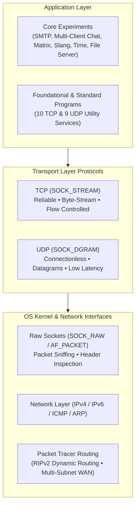

# Computer Networks: Socket Programming & Systems Reference

A comprehensive, production-grade implementation of computer networking protocols, client-server socket architectures, network layer routing simulations, and technical interview foundations in Python.

---

## Architectural Taxonomy



---

## Repository Structure

```text
.
├── README.md                                          # Architectural overview and execution guide
├── THEORETICAL_AND_CONCEPTUAL_QA.md                   # 370-question technical & conceptual compendium
├── requirements.txt                                   # Python environment specification
├── test_suite.py                                      # Automated integration test runner (27/27 suites)
│
├── core_experiments/                                  # Primary multi-tier networking lab implementations
│   ├── 01_matrix_classification_tcp/                  # TCP matrix classification using Python object serialization
│   │   ├── server.py
│   │   └── client.py
│   ├── 02_slang_translator_udp/                       # UDP text normalization & internet slang dictionary
│   │   ├── server.py
│   │   └── client.py
│   ├── 03_time_server_udp/                            # UDP timestamp service with remote shutdown trigger
│   │   ├── server.py
│   │   └── client.py
│   ├── 04_packet_sniffer_raw/                         # Promiscuous Ethernet/IPv4 raw packet capture engine
│   │   └── packet_sniffer.py
│   ├── 05_smtp_mail_transfer_tcp/                     # RFC 822 SMTP simulation state machine
│   │   ├── server.py
│   │   └── client.py
│   ├── 06_multiclient_chat_threaded_tcp/              # Concurrent broadcast chat room with thread synchronization
│   │   ├── server.py
│   │   └── client.py
│   └── 07_concurrent_file_server_multiprocess_tcp/    # Concurrent multi-process file transfer server (PID isolation)
│       ├── server.py
│       ├── client.py
│       └── sample.txt
│
├── standard_programs/                                 # 19 canonical socket programs (TCP & UDP)
│   ├── tcp_01_factorial/                              # Factorial computation over TCP
│   ├── tcp_02_even_odd/                               # Parity evaluation over TCP
│   ├── tcp_03_square/                                 # Square calculation over TCP
│   ├── tcp_04_string_length/                          # String length resolution over TCP
│   ├── tcp_05_string_reverse/                         # String reversal over TCP
│   ├── tcp_06_palindrome/                             # Palindrome verification over TCP
│   ├── tcp_07_uppercase/                              # Uppercase transformation over TCP
│   ├── tcp_08_sum_of_digits/                          # Digit summation over TCP
│   ├── tcp_17_word_count/                             # Sentence word counting over TCP
│   ├── tcp_18_vowel_count/                            # Vowel analysis over TCP
│   ├── udp_09_string_length/                          # String length resolution over UDP
│   ├── udp_10_even_odd/                               # Parity evaluation over UDP
│   ├── udp_11_string_reverse/                         # String reversal over UDP
│   ├── udp_12_palindrome/                             # Palindrome verification over UDP
│   ├── udp_13_square/                                 # Square calculation over UDP
│   ├── udp_14_vowel_count/                            # Vowel analysis over UDP
│   ├── udp_15_uppercase/                              # Uppercase transformation over UDP
│   ├── udp_16_replace_spaces_hyphens/                 # String sanitization over UDP
│   └── udp_19_digit_count/                            # Digit counting over UDP
│
├── foundations/                                       # Core socket paradigm templates
│   ├── tcp_echo/                                      # Minimal TCP byte-stream loopback
│   ├── udp_echo/                                      # Minimal UDP datagram loopback
│   └── tcp_calculator/                                # Client-server RPC arithmetic parser
│
└── packet_tracer_configurations/                      # Cisco IOS CLI router topology and RIP guides
    ├── 01_single_router_rip_configuration.md          # Router interface addressing & RIPv2 protocol activation
    └── 02_dual_router_network_topology.md             # Multi-router WAN interconnect & dynamic routing tables
```

---

## Socket Programming Protocol Matrix

| Protocol / Paradigm | Socket Domain | Socket Type | System Calls / Primitives | Key Characteristics |
| :--- | :--- | :--- | :--- | :--- |
| **TCP Client-Server** | `AF_INET` | `SOCK_STREAM` | `socket`, `bind`, `listen`, `accept`, `connect`, `sendall`, `recv` | Connection-oriented, 3-way handshake (`SYN`, `SYN-ACK`, `ACK`), ordered byte stream, sliding window flow control. |
| **UDP Client-Server** | `AF_INET` | `SOCK_DGRAM` | `socket`, `bind`, `sendto`, `recvfrom` | Connectionless, datagram-preserving, minimal 8-byte header overhead, no retransmission or handshake. |
| **Raw Packet Capture** | `AF_PACKET` | `SOCK_RAW` | `socket(AF_PACKET, SOCK_RAW, htons(3))`, `recvfrom` | Direct Link-layer frame access (Ethernet II), bypassing kernel transport processing; requires root privileges. |
| **Multi-Threaded Server**| `AF_INET` | `SOCK_STREAM` | `threading.Thread`, `threading.Lock`, `sendall` | Shared memory space, cooperative client dispatch, mutex locks for global connection registries. |
| **Multi-Process Server** | `AF_INET` | `SOCK_STREAM` | `multiprocessing.Process`, `os.getpid`, socket descriptor passing | True multi-core execution, memory isolation, individual process IDs per active client connection. |

---

## Core Experiments Guide

Each client-server experiment is decoupled into matching `server.py` and `client.py` scripts. Always launch the server in your primary terminal first before starting the client.

### 1. Matrix Classification over TCP (`01_matrix_classification_tcp`)
- **Architecture**: TCP server (`0.0.0.0:9002`) receives an arbitrary $n \times n$ matrix serialized via Python `pickle`.
- **Classification Logic**:
  - **Diagonal Matrix**: All non-diagonal elements ($i \neq j$) are zero.
  - **Upper Triangular**: All elements below main diagonal ($i > j$) are zero.
  - **Lower Triangular**: All elements above main diagonal ($i < j$) are zero.
  - **Normal Matrix**: Standard matrix failing the structural constraints.
- **Execution**:
  ```bash
  # Terminal 1: Run Server
  python3 core_experiments/01_matrix_classification_tcp/server.py

  # Terminal 2: Run Client (generates an n x n test matrix)
  python3 core_experiments/01_matrix_classification_tcp/client.py 3
  ```

### 2. Slang Translator over UDP (`02_slang_translator_udp`)
- **Architecture**: UDP server (`localhost:9000`) acts as a lookup microservice that normalizes conversational shorthand (e.g., `tbh`, `idk`, `irl`, `asap`, `brb`) into full English sentences using regular expression word boundaries (`\b`).
- **Execution**:
  ```bash
  # Terminal 1: Run Server
  python3 core_experiments/02_slang_translator_udp/server.py

  # Terminal 2: Run Client
  python3 core_experiments/02_slang_translator_udp/client.py "tbh idk what to do rn, brb"
  ```

### 3. UDP Time Server with Remote Control (`03_time_server_udp`)
- **Architecture**: UDP server (`localhost:8001`) returns server timestamps formatted as `YYYY-MM-DD HH:MM:SS`. Upon receiving a `"stop"` token, the server signals acknowledgment and initiates a graceful shutdown.
- **Execution**:
  ```bash
  # Terminal 1: Run Server
  python3 core_experiments/03_time_server_udp/server.py

  # Terminal 2: Run Client
  python3 core_experiments/03_time_server_udp/client.py "time"
  python3 core_experiments/03_time_server_udp/client.py "stop"
  ```

### 4. Raw Socket Packet Sniffer (`04_packet_sniffer_raw`)
- **Architecture**: Uses raw socket primitives (`AF_PACKET`, `SOCK_RAW`) to capture live Ethernet II frames. Unpacks MAC headers (14 bytes), checks for IPv4 EtherType (`0x0800`), and parses IPv4 header fields including Time to Live (TTL), Protocol number (TCP = 6, UDP = 17, ICMP = 1), and 32-bit IP addresses.
- **Execution** *(Requires root privileges on Linux)*:
  ```bash
  sudo python3 core_experiments/04_packet_sniffer_raw/packet_sniffer.py
  ```

### 5. SMTP Mail Transfer State Machine (`05_smtp_mail_transfer_tcp`)
- **Architecture**: Simulates RFC 822 / RFC 5321 Simple Mail Transfer Protocol over TCP port `5025`.
- **Command Sequence & Status Codes**:
  - `220`: Service Ready banner
  - `HELO` $\rightarrow$ `250`: Domain acknowledgment
  - `MAIL FROM:<...>` $\rightarrow$ `250`: Sender accepted
  - `RCPT TO:<...>` $\rightarrow$ `250`: Recipient accepted
  - `DATA` $\rightarrow$ `354`: Start mail input; terminate with `<CRLF>.<CRLF>`
  - `.` $\rightarrow$ `250`: Message delivered successfully
  - `QUIT` $\rightarrow$ `221`: Service closing transmission channel
- **Execution**:
  ```bash
  # Terminal 1: Run Server
  python3 core_experiments/05_smtp_mail_transfer_tcp/server.py

  # Terminal 2: Run Client
  python3 core_experiments/05_smtp_mail_transfer_tcp/client.py alice@org.net bob@corp.com "Sprint Report" "Server deployment verified."
  ```

### 6. Multi-Client Chat Server (`06_multiclient_chat_threaded_tcp`)
- **Architecture**: TCP server (`0.0.0.0:9022`) maintaining a concurrent registry of client connections. Worker threads handle inbound streaming from each client and broadcast messages to all other active peers with thread-safe lock management.
- **Execution**:
  ```bash
  # Terminal 1: Run Server
  python3 core_experiments/06_multiclient_chat_threaded_tcp/server.py

  # Terminal 2 & 3: Run Clients
  python3 core_experiments/06_multiclient_chat_threaded_tcp/client.py Alice
  python3 core_experiments/06_multiclient_chat_threaded_tcp/client.py Bob
  ```

### 7. Concurrent File Server via Multiprocessing (`07_concurrent_file_server_multiprocess_tcp`)
- **Architecture**: High-throughput file retrieval service on port `7200`. For every inbound connection, the parent process dispatches a dedicated `multiprocessing.Process`. Returns the operating system Process ID (`os.getpid()`) alongside the requested file payload, illustrating process isolation and multi-core scaling.
- **Execution**:
  ```bash
  # Terminal 1: Run Server
  python3 core_experiments/07_concurrent_file_server_multiprocess_tcp/server.py

  # Terminal 2: Run Client
  python3 core_experiments/07_concurrent_file_server_multiprocess_tcp/client.py sample.txt
  ```

---

## Standard Curriculum Lab Programs

All 19 standard laboratory exercises are organized into self-contained server/client pairs:

| Program Folder | Protocol | Port | Functionality |
| :--- | :--- | :--- | :--- |
| `standard_programs/tcp_01_factorial` | TCP | 5001 | Computes $N!$ for arbitrary integer input $N$ |
| `standard_programs/tcp_02_even_odd` | TCP | 5002 | Evaluates integer parity (Even vs Odd) |
| `standard_programs/tcp_03_square` | TCP | 5003 | Computes $N^2$ for integer input |
| `standard_programs/tcp_04_string_length` | TCP | 5004 | Computes string character length |
| `standard_programs/tcp_05_string_reverse` | TCP | 5005 | Reverses an input string using slice indexing |
| `standard_programs/tcp_06_palindrome` | TCP | 5006 | Validates string symmetry (Palindrome check) |
| `standard_programs/tcp_07_uppercase` | TCP | 5007 | Transforms text into uppercase ASCII characters |
| `standard_programs/tcp_08_sum_of_digits` | TCP | 5008 | Computes the arithmetic sum of individual digits |
| `standard_programs/tcp_17_word_count` | TCP | 5017 | Counts whitespace-delimited tokens in a sentence |
| `standard_programs/tcp_18_vowel_count` | TCP | 5018 | Computes total vowel occurrences (`a, e, i, o, u`) |
| `standard_programs/udp_09_string_length` | UDP | 6009 | Computes string length over connectionless datagram |
| `standard_programs/udp_10_even_odd` | UDP | 6010 | Computes parity over connectionless datagram |
| `standard_programs/udp_11_string_reverse` | UDP | 6011 | Reverses string over connectionless datagram |
| `standard_programs/udp_12_palindrome` | UDP | 6012 | Evaluates palindrome over connectionless datagram |
| `standard_programs/udp_13_square` | UDP | 6013 | Computes $N^2$ over connectionless datagram |
| `standard_programs/udp_14_vowel_count` | UDP | 6014 | Counts vowels over connectionless datagram |
| `standard_programs/udp_15_uppercase` | UDP | 6015 | Uppercase conversion over connectionless datagram |
| `standard_programs/udp_16_replace_spaces_hyphens` | UDP | 6016 | Replaces space characters with hyphens |
| `standard_programs/udp_19_digit_count` | UDP | 6019 | Counts number of numeric digits in a payload |

---

## Cisco Packet Tracer Network Routing Configurations

The `packet_tracer_configurations/` directory contains step-by-step Cisco IOS configuration scripts and verification routines:
- **[01_single_router_rip_configuration.md](packet_tracer_configurations/01_single_router_rip_configuration.md)**: IOS CLI command hierarchy, GigabitEthernet interface assignment, subnet mask configuration, and Routing Information Protocol (RIPv2) setup.
- **[02_dual_router_network_topology.md](packet_tracer_configurations/02_dual_router_network_topology.md)**: End-to-end multi-router topology (PC1 $\leftrightarrow$ Router 1 $\leftrightarrow$ WAN Serial Link $\leftrightarrow$ Router 2 $\leftrightarrow$ PC2), DCE clock rate synchronization, dynamic route propagation, and ICMP ping verification.

---

## Comprehensive Technical Reference Compendium

The document **[THEORETICAL_AND_CONCEPTUAL_QA.md](THEORETICAL_AND_CONCEPTUAL_QA.md)** aggregates **370 exhaustive technical questions and answers** across 10 critical networking domains:

1. **Network Architectures, Topologies & Layered Models**: OSI 7-layer stack, TCP/IP architecture, protocol data units (PDU), encapsulation, multiplexing/demultiplexing.
2. **Physical & Data Link Layer**: 48-bit MAC addressing, Ethernet II frames, bit/byte stuffing, framing errors, CSMA/CD, CSMA/CA, hidden/exposed terminal phenomena, VLAN segmentation, and IEEE 802.1Q trunking.
3. **Network Layer, Addressing & Subnetting**: 32-bit IPv4 structure, 128-bit IPv6 header simplification, CIDR prefix calculations, variable-length subnet masks (VLSM), ARP address mapping, ICMP control messaging, fragmentation offsets, and Path MTU Discovery.
4. **Routing Protocols & Autonomous Systems**: Distance Vector (Bellman-Ford) vs Link State (Dijkstra) algorithms, Count-to-Infinity prevention (Split Horizon, Poison Reverse, Holddown Timers), RIPv1 vs RIPv2 vs RIPng, OSPF link-state advertisements (LSA) and area hierarchies, BGP path vectors, and Linux routing tables (`ip route`, `netstat -rn`).
5. **Transport Layer Mechanics**: Deep comparison of TCP and UDP, three-way handshake (`SYN`, `SYN-ACK`, `ACK`), connection teardown, TCP state machine (`TIME_WAIT`, `CLOSE_WAIT`), sliding window flow control, Silly Window Syndrome, Nagle's algorithm, and congestion avoidance phases (Slow Start, Congestion Avoidance, AIMD, Fast Retransmit, Fast Recovery).
6. **Application Layer Protocols**: DNS recursive vs iterative query mechanics, HTTP/1.0 vs HTTP/1.1 (keep-alive, pipelining) vs HTTP/2 (binary framing, multiplexing) vs HTTP/3 (QUIC over UDP), SMTP relay architectures, POP3 vs IMAP, FTP control/data separation, and DHCP 4-step DORA negotiation.
7. **Berkeley Sockets API**: Socket file descriptor life cycles, address binding, listen backlog queuing, socket options (`SO_REUSEADDR`), blocking vs non-blocking I/O, network byte order conversions (`htons`, `ntohs`, `htonl`, `ntohl`), and serialization.
8. **Concurrency, I/O Multiplexing & Raw Sockets**: Iterative vs concurrent server models, multi-threading vs multi-processing tradeoffs, Python Global Interpreter Lock (GIL) implications, kernel I/O multiplexing (`select`, `poll`, `epoll`), and raw socket access (`AF_PACKET`, `SOCK_RAW`).
9. **Network Security, QoS & Diagnostic Tools**: Traffic shaping mechanisms (Leaky Bucket vs Token Bucket), DiffServ DSCP prioritization, Wireshark display and capture filtering syntax, diagnostic utilities (`ping`, `traceroute`, `arp`, `tcpdump`, `ss`), and SYN flood attack mitigation.
10. **Lab Program Technical Solutions**: In-depth explanations for all 19 standard programs, multi-client chat broadcasting algorithms, and multiprocessing file distribution.

---

## Verification & Automated Test Suite

An automated end-to-end integration test runner is included to validate socket communication across every implemented program:

```bash
python3 test_suite.py
```

### Test Suite Execution Output
```text
=================================================================
  COMPUTER NETWORKS SOCKET PROGRAMMING VERIFICATION SUITE
=================================================================
[PASS] foundations/tcp_echo                               -> OK
[PASS] foundations/udp_echo                               -> OK
[PASS] foundations/tcp_calculator                         -> OK
[PASS] standard_programs/tcp_01_factorial                 -> OK
[PASS] standard_programs/tcp_02_even_odd                  -> OK
[PASS] standard_programs/tcp_03_square                    -> OK
[PASS] standard_programs/tcp_04_string_length             -> OK
[PASS] standard_programs/tcp_05_string_reverse            -> OK
[PASS] standard_programs/tcp_06_palindrome                -> OK
[PASS] standard_programs/tcp_07_uppercase                 -> OK
[PASS] standard_programs/tcp_08_sum_of_digits             -> OK
[PASS] standard_programs/tcp_17_word_count                -> OK
[PASS] standard_programs/tcp_18_vowel_count               -> OK
[PASS] standard_programs/udp_09_string_length             -> OK
[PASS] standard_programs/udp_10_even_odd                  -> OK
[PASS] standard_programs/udp_11_string_reverse            -> OK
[PASS] standard_programs/udp_12_palindrome                -> OK
[PASS] standard_programs/udp_13_square                    -> OK
[PASS] standard_programs/udp_14_vowel_count               -> OK
[PASS] standard_programs/udp_15_uppercase                 -> OK
[PASS] standard_programs/udp_16_replace_spaces_hyphens    -> OK
[PASS] standard_programs/udp_19_digit_count               -> OK
[PASS] core_experiments/01_matrix_classification_tcp      -> OK
[PASS] core_experiments/02_slang_translator_udp           -> OK
[PASS] core_experiments/03_time_server_udp                -> OK
[PASS] core_experiments/05_smtp_mail_transfer_tcp         -> OK
[PASS] core_experiments/07_concurrent_file_server_multiprocess_tcp -> OK
=================================================================
Summary: 27 PASSED, 0 FAILED out of 27 automated suites.
=================================================================
```
